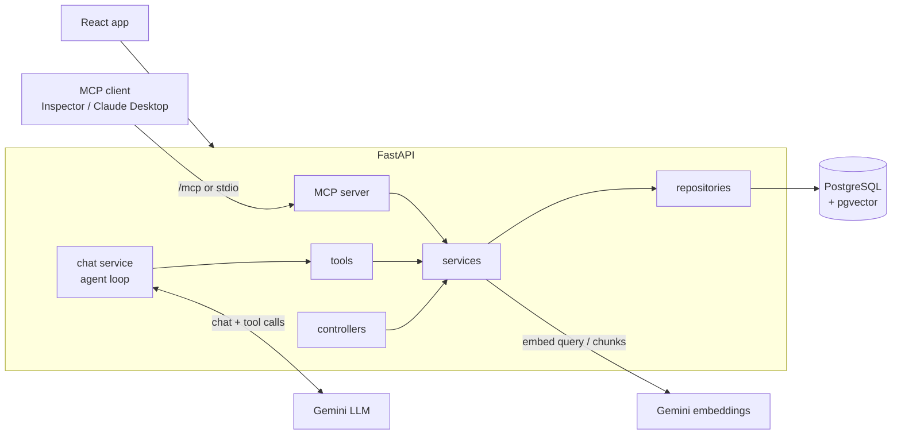

# BariBhara (বাড়িভাড়া) — AI rent & building manager for Dhaka landlords

BariBhara helps small landlords and building committees in Dhaka run their buildings: flats, tenants, leases, the monthly rent ledger and repair requests, plus an AI assistant that answers from the real data and the building's own documents, in Bangla or English.

| Link | |
|---|---|
| Git repo | https://github.com/Hazrat-Ali9/Phitron-AI-ML-Final |
| Demo video (Google Drive) | _add link_ |
| Live API docs (Swagger) | https://baribhara-api.onrender.com/docs |
| Live web app | _https://baribhara-web.onrender.com/_ |

## The problem

A typical Dhaka landlord owns one to three buildings with 5–20 flats. Today:

- Rent is tracked in a paper **khata** (ledger) and a phone full of bKash SMS. Nobody can say in one glance who still owes rent this month.
- Tenants call the owner or caretaker for everything: "when is rent due?", "is gas included?", "the sink is leaking".
- Repair complaints are forgotten because they live in phone calls.
- Vacant flats are advertised with a "To-Let" sign on the gate.

**Customer:** landlords with 1–3 buildings and building committees (owner, a caretaker, and the tenants).

## Features by role

| Role | Can |
|---|---|
| **Owner** (`admin`) | Everything: buildings, flats, tenants and leases, the rent ledger (record bKash/Nagad/bank/cash payments), the maintenance board, and the assistant ("who hasn't paid this month?", "rent reminder in Bangla") |
| **Caretaker** (`staff`) | Read flats and users, see and update repair requests (assign, in progress, resolved), use the assistant |
| **Tenant** | See their own lease, dues and payment history, report repairs for their flat, and ask the assistant ("how much do I owe?", "my sink is leaking", "can I keep a cat?") |

The assistant:

- **Tool calling:** reads the tenant's own dues, lists vacant flats, creates repair requests and gives the owner a collection report. It is only offered the tools the caller's role may use.
- **RAG:** answers rules, tenancy, utility and legal questions from six building documents and shows the sources. If the documents don't cover a question, it says *"I couldn't find that in the building's documents."*
- **Multi-turn:** the conversation history is sent with each message.

### Screenshots

_Add screenshots to `docs/screenshots/` and link them here: owner dashboard, rent ledger, maintenance board, tenant home, assistant answering with a tool and with sources._

## Business model

- **Free** up to 4 flats (one small building), so a landlord can try it with no risk.
- **৳25 per flat per month**, or **৳499 per building per month** (whichever is lower), for unlimited users of that building.
- **৳2,000 one-time setup** where we enter the existing khata, tenants and leases for the owner.

**Why a landlord pays:** it replaces the rent khata, the end-of-month phone calls, the "To-Let" sign and lost repair complaints. One recovered month of late rent per year (৳20,000+) pays for years of the subscription.

## Tech stack

| Part | Choice |
|---|---|
| API | Python 3.12, FastAPI, Pydantic v2, `uv` |
| Database | PostgreSQL 16 + **pgvector**, SQLAlchemy 2 (async, `asyncpg`), Alembic migrations |
| Auth | JWT (HS256, `pyjwt`), argon2id password hashing (`pwdlib`), roles read from the DB on every request |
| LLM | Google **Gemini** through its OpenAI-compatible API (`openai` SDK). Any OpenAI-compatible provider works by changing `.env` |
| Embeddings / RAG | Gemini `gemini-embedding-001` at 768 dimensions (multilingual, handles Bangla), pgvector HNSW cosine index |
| MCP | Official `mcp` SDK (v2 `MCPServer`), streamable HTTP at `/mcp` and stdio |
| Frontend | React 19, TypeScript, Vite, Tailwind CSS, TanStack Query (see [frontend/README.md](frontend/README.md)) |
| Deploy | Docker, docker compose, Render (Blueprint in [render.yaml](render.yaml)) |

## Architecture



Code layout (`backend/app/`):

- `core/`: settings, database, security (hashing and JWT), errors and global handlers.
- `modules/<name>/`: one folder per feature (`users`, `auth`, `buildings`, `flats`, `leases`, `payments`, `maintenance`, `knowledge`, `chat`). Each has `controllers` (HTTP only), `services` (business rules), `repositories` (SQL only), `schemas`, `models` and `dependencies` (wired with `Depends`).
- `integrations/`: the LLM client and the embeddings client. The rest of the app never imports the provider SDK directly.
- `mcp/`: the MCP server, using the same services as the API.

**Data flows**

1. **API:** request → controller → `Depends` builds repository → service → service applies rules → repository queries Postgres → Pydantic schema → JSON.
2. **Chat:**
   1. The service builds a system prompt with the user's name, role, flat and today's date, and adds the history.
   2. It calls the LLM with only the tools that role may use.
   3. If the model asks for a tool, the arguments are validated and the tool runs through the normal services against the real DB. The result goes back to the model.
   4. This repeats, up to 5 rounds, until the model gives its final answer. The response lists the tools used and the sources.
3. **RAG:**
   1. `scripts/ingest.py` splits each document on `##` headings, then into ~800-character chunks with overlap.
   2. Each chunk is embedded and stored in `knowledge_chunks.embedding vector(768)`.
   3. A question is embedded and the nearest chunks are found by cosine distance (HNSW index). Chunks scoring below `RAG_MIN_SCORE` are dropped.
   4. If nothing is left, the assistant says it couldn't find the answer.
4. **MCP:** Inspector or Claude Desktop → `/mcp` (HTTP) or `scripts/mcp_stdio.py` (stdio) → tool → service → DB.
5. **Auth:**
   - Register hashes the password with argon2id. Login checks it and returns a JWT with `sub`, `iat` and `exp`.
   - On every request the token is decoded and the user and role are loaded **from the database**, so a disabled user or a changed role takes effect at once.
   - `require_roles(...)` returns 403 for other roles. Tenants only ever see their own leases, payments and requests: someone else's comes back as 404, so the API doesn't reveal that it exists.

## Run it locally (docker compose)

Requirements: Docker with compose, and a Gemini API key (free at <https://aistudio.google.com/apikey>).

```bash
git clone https://github.com/Hazrat-Ali9/Phitron-AI-ML-Final && cd BariBhara
cp .env.example .env
#   - set LLM_API_KEY to your Gemini key (embeddings reuse it)
#   - set JWT_SECRET_KEY to the output of: openssl rand -hex 32
docker compose up -d --build                         # db, api (runs migrations), frontend
docker compose exec api python -m scripts.seed       # demo data (safe to run twice)
docker compose exec api python -m scripts.ingest     # embed the 6 documents for RAG
```

- API docs: <http://localhost:8000/docs> (click **Authorize** and paste the `access_token` from `/api/v1/auth/login`)
- Web app: <http://localhost:5173>
- MCP: <http://localhost:8000/mcp>

The API refuses to start with a clear error if a required setting, such as `JWT_SECRET_KEY` or `LLM_API_KEY`, is missing. The error names the missing settings without printing any secret values.

### Without Docker (development)

```bash
docker compose up -d db
cd backend
uv sync
uv run alembic upgrade head
uv run python -m scripts.seed
uv run python -m scripts.ingest
uv run uvicorn app.main:app --reload
uv run pytest            # tests use a separate, freshly migrated baribhara_test database
```

## Demo logins

| Role | Email | Password |
|---|---|---|
| Admin | hazrat@baribhara.app | admin123 |
| Owner | rahman@baribhara.app | admin123 |
| Caretaker | karim@baribhara.app | staff123 |
| Tenant (owes this month's rent) | tanvir.hasan@gmail.com | tenant123 |
| Other tenants | nusrat.jahan@gmail.com, farhana.akter@yahoo.com, mahmud.islam@gmail.com, … | tenant123 |

The seed creates 3 buildings (Mirpur, Dhanmondi, Uttara), 16 flats, 9 active leases, 3 months of rent records (this month is a mix of paid, partial and due) and 6 repair requests.

## Example requests

```bash
API=http://localhost:8000/api/v1

# Login (wrong email and wrong password give the same 401 message)
TOKEN=$(curl -s -X POST $API/auth/login -H 'Content-Type: application/json' \
  -d '{"email":"rahman@baribhara.app","password":"admin123"}' | jq -r .access_token)

# CRUD: vacant 3-bedroom flats in Uttara under ৳30,000
curl -s "$API/flats?status=vacant&area=Uttara&bedrooms=3&max_rent=30000" -H "Authorization: Bearer $TOKEN"

# Create a flat (201; 409 if the flat number already exists in that building)
curl -s -X POST $API/flats -H "Authorization: Bearer $TOKEN" -H 'Content-Type: application/json' \
  -d '{"building_id":1,"flat_no":"6A","floor":6,"bedrooms":3,"bathrooms":2,"size_sqft":1250,"monthly_rent":23000,"service_charge":2000}'

# Chat (multi-turn: send earlier turns in "history")
curl -s -X POST $API/chat -H "Authorization: Bearer $TOKEN" -H 'Content-Type: application/json' \
  -d '{"message":"Who has not paid rent this month?","history":[]}'
```

A tenant asking `"How much rent do I owe?"` gets an answer from the `get_my_rent_status` tool. `"Is the gas bill included?"` is answered from the Utilities Guide, with sources. `"Who won the cricket match?"` gets "I couldn't find that…".

## API overview (33 endpoints, all under `/api/v1`)

| Area | Endpoints | Who |
|---|---|---|
| Health | `GET /health` (checks the DB) | public |
| Auth | `POST /auth/register` (always a tenant), `POST /auth/login`, `GET /auth/me` | public / any |
| Users | `GET /users?role=&q=` | owner, caretaker |
| Buildings | `GET/POST /buildings`, `GET/PATCH/DELETE /buildings/{id}` | read: all · write: owner |
| Flats | `GET/POST /flats` (filters `q, building_id, area, status, bedrooms, min_rent, max_rent`), `GET/PATCH/DELETE /flats/{id}` | read: all · write: owner |
| Leases | `GET/POST /leases`, `GET/PATCH/DELETE /leases/{id}` | owner · tenant (own, read) |
| Rent payments | `GET/POST /payments`, `GET/PATCH/DELETE /payments/{id}` | owner · tenant (own, read) |
| Maintenance | `GET/POST /maintenance`, `GET/PATCH/DELETE /maintenance/{id}` | all (tenant: own) · update: owner, caretaker · delete: owner |
| Chat | `POST /chat` | all |
| Knowledge | `GET /knowledge/documents`, `POST /knowledge/search` | owner / all |

Every list endpoint takes `limit` (default 100, max 200) and `offset`. Status codes:

| Code | Meaning |
|---|---|
| 201 | Created |
| 204 | Deleted |
| 401 | Missing, invalid or expired token |
| 403 | Wrong role |
| 404 | Not found |
| 409 | Duplicate email or building, flat number already in that building, the flat already has an active lease, a rent record already exists for that lease and month, or deleting something still in use |
| 422 | Validation error. Includes BD mobile numbers (`01[3-9]XXXXXXXX`), NID numbers (10, 13 or 17 digits) and months (`YYYY-MM`) |
| 503 | The LLM or embedding provider is down |

Business rules:

- A flat has at most one active lease. This is checked in the service and enforced by a partial unique index.
- Starting or ending a lease keeps the flat's status in sync (`occupied` / `vacant`; a flat under maintenance stays that way).
- A payment's status (`paid` / `partial` / `due`) is computed from the amounts.
- A tenant can only report repairs for the flat on their active lease.

## RAG: documents and threshold

The documents are in [`backend/knowledge/`](backend/knowledge): house rules, tenancy agreement terms, a utilities guide (DESCO/DPDC prepaid meters, Titas gas, WASA, generator), a plain-language summary of the Premises Rent Control Act 1991, a move-in/move-out guide, and emergency contacts.

`RAG_MIN_SCORE` is the cosine-similarity cut-off. To tune it, log in as the owner and call `POST /api/v1/knowledge/search` with `"min_score": 0`, so every score comes back. Use 5 on-topic questions (gas bill, notice period, guests, late fee, prepaid meter) and 5 off-topic ones (cricket, weather, recipes), then pick a value between the two groups.

Ingest is idempotent: a file is re-embedded only when its content or the embedding model changes. Run with `--force` to re-embed everything.

## MCP server

Tools:

- `list_vacant_flats(area?, max_rent?, bedrooms?)`
- `get_rent_due_summary(month?)`
- `create_maintenance_request(flat_id, title, description, category, priority?)`
- `search_building_documents(query)`

Resource: `baribhara://buildings/{building_id}/summary`. Prompt: `rent_reminder(tenant_name, amount_due, month, language)`.

MCP calls have no logged-in user, so they **act as the owner** (the first admin). For example, a repair created over MCP is "reported by" the owner.

```bash
# HTTP (server running): connect the Inspector to http://localhost:8000/mcp
npx @modelcontextprotocol/inspector

# stdio
npx @modelcontextprotocol/inspector uv --directory backend run python -m scripts.mcp_stdio
```

If `MCP_API_KEY` is set, `/mcp` requires the header `X-API-Key: <key>`.

## Deploy on Render

1. In Render, choose **New → Blueprint** and pick this repo. [render.yaml](render.yaml) creates a free Postgres database, the API (Docker) and the web app (static site).
2. Fill in the values it asks for:
   - `LLM_API_KEY`: your Gemini key.
   - `CORS_ORIGINS`: the web app URL, e.g. `https://baribhara-web.onrender.com`.
   - `VITE_API_URL`: the API URL, e.g. `https://baribhara-api.onrender.com`.
3. Render provides `postgres://…`. The settings validator rewrites it to `postgresql+asyncpg://…` (and `sslmode` to `ssl`). The first migration creates the `vector` extension.
4. The free tier has no shell, so the API seeds and ingests on start (`SEED_ON_START`, `INGEST_ON_START`). Both are idempotent.
5. Embeddings come from the Gemini API, so no model container runs on Render. That's why Gemini embeddings were chosen over a self-hosted model.

Free instances sleep after ~15 minutes, so the first request after that takes about a minute. Free Render Postgres databases also expire after a limited time; check Render's current free-tier limits before the demo.

## Tests

`cd backend && uv run pytest` runs 68 tests against a separate `baribhara_test` database. They cover:

- auth, roles and token expiry
- CRUD rules (409s, 422s, tenant isolation, flat status sync)
- the agent loop, using a scripted fake LLM
- RAG plumbing, using a fake embedder
- the embeddings client fallbacks
- the MCP tools, resource and prompt
- settings validation
